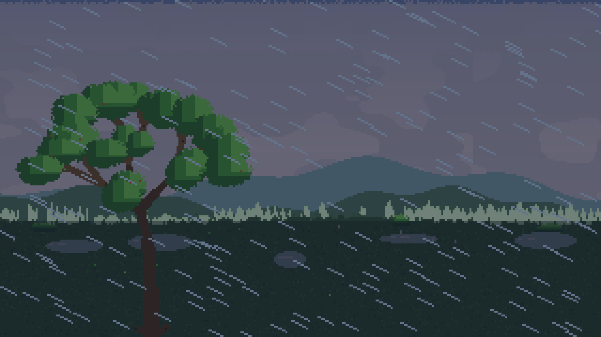
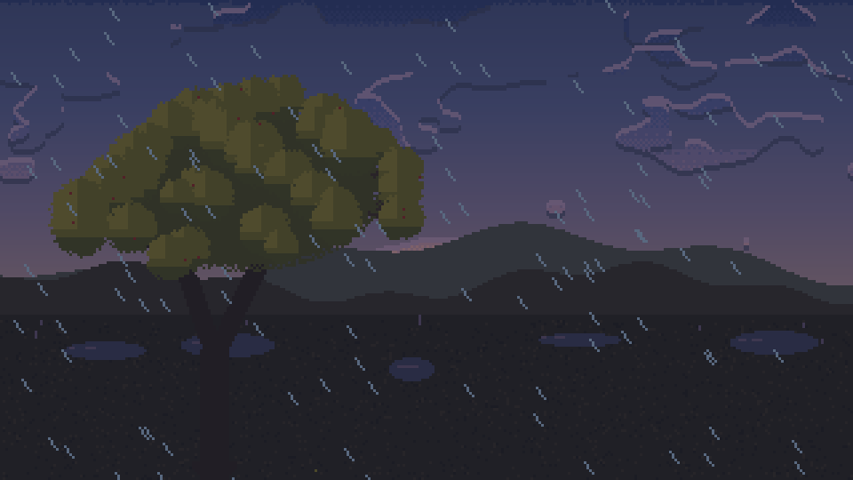

# Weather Tree

Пиксельный погодный экран: живёт на `canvas` и показывает дерево в том состоянии,
в котором оно было бы в реальности прямо сейчас — с учётом времени года, времени суток,
широты и текущей погоды в выбранной точке.

**Демо:** <https://inomasadji.github.io/weather-tree/>

**Состояние на 14.11.2026:** M0–M12 · 183 теста + e2e · 0 зависимостей · кадр ~0.6 мс
(3.7 мс под эмуляцией слабого CPU ×4) · 18 golden-кадров · 4 породы + 2.5D-пейзаж · `ru`/`en` ·
оба сценария из ТЗ воспроизводятся на проде. Известные долги —
[docs/AUDIT.md](docs/AUDIT.md) и [открытые issues](https://github.com/inomasadji/weather-tree/issues).

| Рассвет в июле | Зимние сумерки, иней | Осенний дождь |
|---|---|---|
|  |  |  |

| Лето, полдень, ясно | Зима, 19:15, метель | Закат |
|---|---|---|
|  |  |  |

| Туман | Гроза | Дождь |
|---|---|---|
|  |  |  |

## Как это работает

Дерево — не переключатель «4 сезона × 3 погоды», а непрерывная модель:

1. **Место.** Сохранённый город → геолокация → IP → Москва. Погода — от Open-Meteo,
   при блокировке — от `wttr.in`. Рабочий провайдер запоминается.
2. **Время.** Часы идут по часовому поясу точки, а не устройства.
3. **Сезон.** Фенологическая кривая года: почки → молодая листва → полная крона →
   пожелтение → листопад → голые ветки. Полушарие учитывается.
4. **Солнце и луна.** Высота и азимут считаются астрономически, поэтому возможны
   полярный день, полярная ночь, сумерки шести стадий и фаза луны.
5. **Погода.** Ветер гнёт ствол иерархически, снег ложится на ветви и землю,
   дождь мочит кору, туман съедает дальний план, гроза подсвечивает небо.
6. **Рендер.** Логический буфер 320×180, целочисленный апскейл, палитра ≤ 32 цветов,
   дизеринг Байера. Всё процедурно: ни одного бинарного ассета.

## Стек

| Слой | Решение |
|------|---------|
| Хостинг | GitHub Pages (статика) |
| Сборка | отсутствует, нативные ES-модули |
| Зависимости | **0** npm-пакетов |
| Рендер | Canvas 2D, `putImageData`, `image-rendering: pixelated` |
| Погода | Open-Meteo (основной) + wttr.in (фолбэк), оба без ключа |
| Геокодинг | Open-Meteo Geocoding, BigDataCloud (обратный), ipwho.is (IP) |
| Тесты | `node --test`, golden-кадры по SHA-256 |

## Запуск

```bash
npm start          # статический сервер на http://localhost:5173 (без зависимостей)
npm test           # 159 тестов: модель, породы, 2.5D-пейзаж, API, контроллер, i18n, бюджет, golden-кадры
npm run e2e        # браузерный e2e-смоук (headless Edge/Chrome по CDP, без зависимостей)
npm run snapshot   # PNG-кадры сценариев в snapshots/out + замер времени
```

### Машина времени

Проверить любой сценарий можно без сети и без ожидания нужной погоды:

```
http://localhost:5173/?demo=1&at=2026-01-14T19:15&code=75&temp=-11&cloud=95&wind=28&gust=45
```

* `at` — момент времени (ISO), `code` — код WMO, `temp` — °C, `cloud` — %, `wind`/`gust` — км/ч;
* `lat`, `lon`, `name`, `tz` — точка (по умолчанию Москва);
* всё это только при `demo=1`; плашка в HUD честно показывает «демо».

## Приватность

Координаты перед отправкой в сервисы погоды и геокодирования округляются до 2 знаков (~1 км),
хранятся только локально в `localStorage`, аналитика и сторонние трекеры отсутствуют.

## Документация

* [docs/PLAN.md](docs/PLAN.md) — план, этапы, риски.
* [docs/WEATHER-MAPPING.md](docs/WEATHER-MAPPING.md) — таблица «состояние мира → кадр».
* [docs/AUDIT.md](docs/AUDIT.md) — аудит после MVP: найденные проблемы и приоритеты.
* [AGENTS.md](AGENTS.md) — правила разработки.

## Лицензия

MIT
